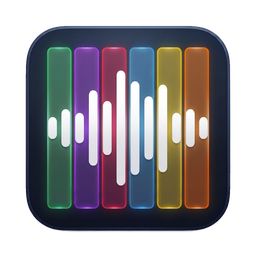
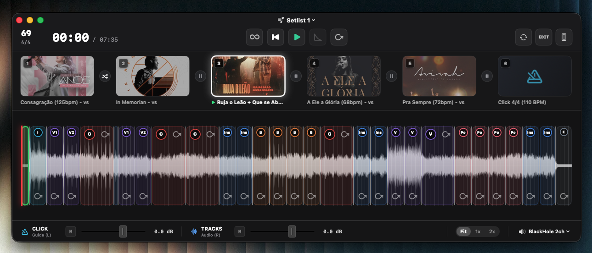
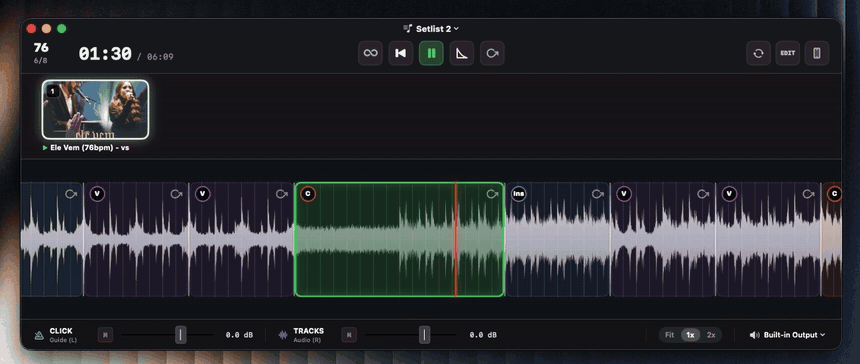
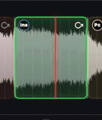
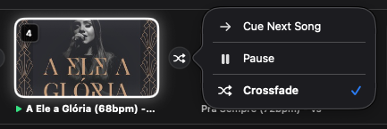
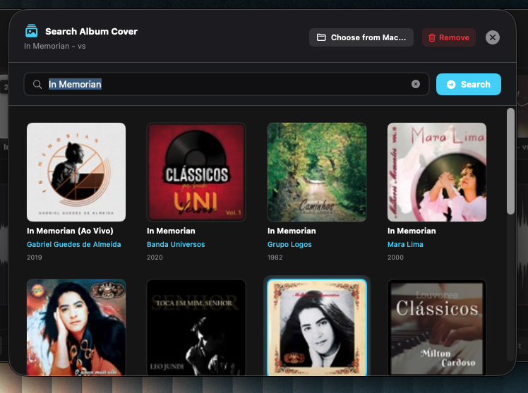

<div align="center">



# VS Control

**Playback de Multitracks Split (L/R) para Palco e Apresentações ao Vivo**

Uma estação de áudio nativa para macOS focada em estabilidade, resposta imediata e controle em tempo real.<br>
Sem DAWs pesadas, sem multitracks complexas e sem complicação no palco.

<br>

[](https://apple.com)
[](https://swift.org)
[](https://developer.apple.com/documentation/coreaudio)
[](LICENSE)

<br><br>



</div>

<br>

## O Conceito Split (L / R)

Desenvolvido sob medida para arquivos estéreo divididos (*split stereo*), o VS Control elimina o alto consumo de CPU e memória de softwares convencionais, garantindo carregamento instantâneo de faixas e estabilidade absoluta durante o show.

| Canal | Conteúdo | Destino Principal | Função |
| :---: | :--- | :--- | :--- |
| **L** | **Click + Voz Guia** | Fones / In-Ear dos músicos | Metrônomo sincronizado e contagens de seção (*Intro*, *Verso*, *Refrão*…) |
| **R** | **Master Tracks** | Mesa de Som / P.A. | Mix instrumental da banda (pads, sintetizadores, guitarras, backing vocals) |

<br>

## Veja em Ação

### Salto Quantizado no Tempo 1
Liberdade para alterar a estrutura do arranjo ao vivo. O disparo aguarda com precisão matemática o **tempo 1 (downbeat)** do próximo compasso, emitindo a voz guia antecipada no canal L para avisar a banda sem interromper o som do P.A.

<div align="center">
  
</div>

<br>

### Loop de Seção
Mantenha qualquer parte da música (*Refrão, Ponte ou Instrumental*) em repetição contínua instantânea com a tecla `L` ou botão dedicado, permitindo ministrações e solos espontâneos sem perder a sincronia do clique.

<div align="center">
  
</div>

<br>

### Transição Customizada por Faixa
Configure o comportamento de passagem entre cada música do seu repertório com 1 clique direto no carrossel:
- **Cue Next Song:** Carrega e aguarda o disparo da próxima faixa.
- **Pause:** Pausa automaticamente a reprodução ao final da música atual.
- **Crossfade:** Transição contínua sem pausas, iniciando a contagem de voz guia imediatamente no canal L enquanto a música anterior finaliza suavemente.

<div align="center">
  
</div>

<br>

## Recursos Principais

- **Timeline Acelerada por Metal:** Forma de onda contínua renderizada via GPU a 60 fps, com blocos coloridos e divisão visual nítida por seções musicais.
- **Detecção Inteligente de Seções:** Análise nativa de transientes de clique e transcrição fonética local via Whisper.cpp (100% offline, sem dependências externas).
- **Fade Inteligente de P.A. (`Tecla 0`):** Reduz gradualmente o instrumental no P.A. em 3 segundos, mantendo o metrônomo e as guias ativas nos fones dos músicos.
- **Setlists Dinâmicas (`.vset`):** Organização de repertório com reordenação por *drag-and-drop*, modo de edição protegido contra cliques acidentais e histórico completo com `⌘ Z`.
- **Mapeamento Direto (KEY MAP & MIDI MAP):** Mapeamento rápido de teclas do computador e controladores MIDI físicos com visual intuitivo inspirado em DAWs de referência.

<br>

### Capas de Álbum & Personalização Visual
Identificação imediata das faixas no palco através das artes oficiais. Pesquise capas de álbuns online direto pelo aplicativo ou escolha qualquer imagem personalizada do seu Mac.

<div align="center">
  
</div>

<br>

## Roteamento de Áudio com BlackHole 2ch

Para rotear o áudio do VS Control diretamente para DAWs ou softwares de transmissão (OBS Studio):

```bash
./scripts/install_blackhole.sh
sudo killall coreaudiod
```

O **BlackHole 2ch** aparecerá automaticamente no seletor de saídas de áudio do aplicativo.

<br>

## Licença

Copyright &copy; 2026 **Samys Glauber**. Todos os direitos reservados.

Este software e seu código-fonte são proprietários. É proibida qualquer cópia, distribuição, modificação ou uso comercial sem autorização prévia por escrito do autor.

<br>

<div align="center">
  <sub>Feito sob medida para quem toca ao vivo.</sub>
</div>
