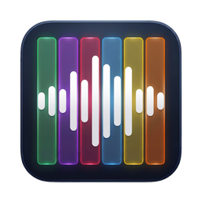
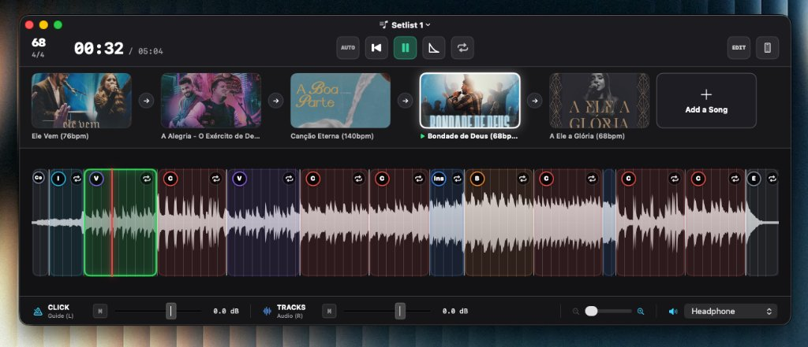

<div align="center">



# VS Control

**Playback de VSs split (L/R) para o palco • Nativo para macOS**

Leve, rápido e confiável. Sem multitracks pesadas, sem complicação.


<br>



</div>

<br>

## 🎚️ Conceito Split (L/R)

Feito sob medida para arquivos de áudio **split de dois canais**, o VS Control elimina a lentidão e o consumo excessivo de memória de softwares pesados, entregando carregamento imediato de faixas, troca instantânea de repertório e estabilidade absoluta ao vivo.

| Canal | Conteúdo | Destino | Função |
|:---:|:---|:---|:---|
| 🔈 **L** | **Click + Voz Guia** | Fones / In-Ear | Metrônomo e contagens de seção (*"Intro 2, 3, 4"*, *"Verso"*, *"Refrão"*…) |
| 🔊 **R** | **Mix do VS** | Mesa de som / P.A. | Instrumental completo pré-mixado (pads, synths, guitarras, backing vocals) |

<br>

## ✨ Recursos em Destaque

<table>
<tr>
<td width="50%" valign="top">

### 🎛️ Timeline & Mapeamento de Seções
Forma de onda contínua com blocos coloridos para cada parte da música (*Intro, Verso, Refrão, Ponte, Ending*...).

- **Detecção inteligente:** Mapeamento visual das seções ao longo do espectrograma.
- **Edição em compassos:** Ajuste fino de compassos inteiros e meios compassos (`-1`, `-½`, `+½`, `+1`).
- **Menu de contexto:** Clique com botão direito em qualquer trecho para renomear, dividir ou alterar cores.

</td>
<td width="50%" valign="top">

### ⏱️ Salto Quantizado no Tempo 1
Liberdade para alterar a estrutura do arranjo ao vivo sem sair do tempo com o baterista.

- **Zero quebra de ritmo:** O salto sempre aguarda o tempo 1 do próximo compasso.
- **Repetição fluida:** Repita um refrão, estenda uma ponte ou pule direto para o final.
- **Loop dedicado:** Tecla `L` para manter qualquer trecho em repetição contínua.

</td>
</tr>
<tr>
<td width="50%" valign="top">

### 📋 Setlists Dinâmicas (`.vset`)
Gerenciamento de repertório completo pronto para apresentações e cultos.

- **Menu na barra de título:** Troca instantânea e salvamento de setlists em 1 clique.
- **Transição inteligente:** Escolha entre `AUTO` (emenda na próxima faixa) ou `STOP` (aguarda disparo).
- **Foco no palco:** Opacidade de 100% na música ativa e 70% nas demais para leitura rápida no escuro.
- **Drag & Drop:** Reorganize a ordem das faixas arrastando os cards na barra inferior.

</td>
<td width="50%" valign="top">

### 🌅 Fade Inteligente (P.A. vs Fone)
Controle de volume suave para falas, transições ou ministrações espontâneas.

- **Fade Out em 3 segundos:** Reduz gradualmente o volume do instrumental no P.A.
- **Click e Guia ativos:** O metrônomo continua tocando nos fones dos músicos.
- **Fade In reverso:** Um segundo clique no botão reverte o efeito, trazendo o volume de volta.

</td>
</tr>
<tr>
<td width="50%" valign="top">

### 📱 Controle Remoto sem Fio
Controle o playback de qualquer lugar do palco direto do seu smartphone ou tablet.

- **Conexão instantânea via QR Code:** Basta apontar a câmera do celular na tela.
- **Interface móvel tátil:** Botões grandes para disparo rápido perto do seu instrumento.
- **Comunicação WebSocket:** Latência zero e feedback em tempo real na mesma rede Wi-Fi.

</td>
<td width="50%" valign="top">

### 🔒 Modo de Edição & Desfazer Total
Máxima estabilidade e segurança para apresentações ao vivo.

- **Trava de segurança (Edit Mode):** Evita exclusões ou alterações acidentais durante o show.
- **Histórico completo (Undo/Redo):** Atalhos `⌘ Z` e `⇧ ⌘ Z` para até 50 passos com persistência no disco.
- **Feedback visual imediato:** Notificações discretas na tela a cada ajuste realizado.

</td>
</tr>
</table>

<br>

## ⌨️ Atalhos de Teclado

| Tecla | Ação |
|:-----:|------|
| `Espaço` | Iniciar / Pausar reprodução |
| `←` / `→` | Navegar pelas seções da música |
| `Enter` | Disparar salto quantizado para a seção selecionada |
| `Esc` | Cancelar foco / seleção de seção |
| `L` | Ativar / desativar loop da seção |
| `0` | Disparar Fade Out / Fade In das faixas (3s) |
| `1` a `8` | Disparar diretamente as músicas 1 a 8 da setlist |
| `⌘ Z` | Desfazer edição de seções (até 50 passos) |
| `⇧ ⌘ Z` | Refazer edição de seções |
| `⌘ N` | Criar novo setlist |
| `⌘ O` | Abrir arquivo de setlist (`.vset`) |
| `⌘ S` | Salvar setlist atual |
| `⇧ ⌘ S` | Salvar setlist como... |

<br>

## 🚀 Instalação e Execução

### Abrir o aplicativo pronto
1. Dê dois cliques em **`VS Control.app`** na raiz do projeto.
2. *(Opcional)* Arraste para a pasta **/Applications** ou adicione ao **Dock**.

### Compilar a partir do código-fonte
```bash
swiftc swift_app/main.swift -o "VS Control.app/Contents/MacOS/VSControl"
```

<br>

## 🔊 Roteamento de Áudio com BlackHole 2ch

Para rotear o áudio do VS Control para DAWs ou softwares de transmissão:

```bash
./scripts/install_blackhole.sh
sudo killall coreaudiod
```

O **BlackHole 2ch** aparecerá automaticamente no seletor de saídas do aplicativo.

<br>

<div align="center">

<sub>Feito para quem toca ao vivo.</sub>

</div>
